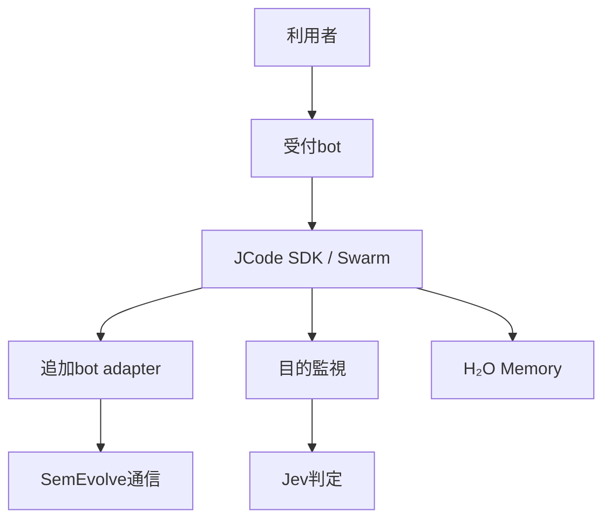

# 設計案と実装状況

基点: JCode `f60280ebc49395f077975e7408fc3fe8759f02d1`。このチェックアウトは上流のローカルクローンであり、GitHub上のforkではない。

上図は目標構成。現状は独立試作品のみであり、図中の接続はまだ動作しない。

## 目的監視

Jevに渡すのは明示された目的、制約、観測済みアクション、期待・観測結果に限定する。ログを逆順に走査して逸脱の手掛かりを提示することはできるが、モデルの隠れた推論の逆アセンブルではない。二分木は進行か逸脱かという意思決定の分岐を指し、大小順の二分探索木ではない。単調性がないため、過去の境界を二分探索で正確に特定できるとは仮定しない。

判定は `aligned` / `misaligned` / `unknown` とする。逸脱の際に修正回数を消費し、上限後も逸脱なら枝だけを停止。unknownは回数を消費せず保留。途中で寄与を回復すれば続行するが、回数は枝全体で有限に保つ。履歴と成果の保持・再開は将来の永続event logで行う。試作品ではステートはメモリ上だけで、Jev・Swarmに接続されていない。

## 記憶

研究上の相の名前は保つが、この試作品のIce/Waterはともに完全な作業用コピーをRAMに保持し、Vapourはそのコピーを捨ててdisk原本から戻す。要約・索引・圧縮や自動遷移はまだない。ice/water/vapourはユーザーが先に定めた正確な相の意味を再現したという主張ではない。

`experiments/h2o-drift` は簡易原本保存・ID上書き拒否・相遷移・再読取と決定状態機械の独立Rust crate。実際の消費メモリを計測しておらず、他プロセスやKVキャッシュを小さくしない。原本への排他、耐障害コミット、同意、削除、版・監査、復旧、権限は未実装。非公開・重要データには使わない。

## SemEvolveと受付

SemEvolveの仕様に合わせ、内部言語は自然言語限定にせず、受領と理解を区別する。SQLite hubまたはadapterの設計・実装・接続は未着手。既存のSemEvolveの研究実験、DBや承認状態を変更しない。

JCode SDKの`CreateSessionOptions.working_dir`は任意だが、省略時はruntimeの既定ディレクトリになる。従って「受付に入力不要」であることと「ファイル操作対象が安全に決まる」ことは別。受付セッションでは作業対象確定まで編集権限を付けず、対象確定後に作業セッションへ渡す必要がある。Grok Botの外観は未確認。

## 次の作業

1. 本人のGitHubにforkを作り、上流追跡と作業ブランチを確立する。
2. H₂O実装の実際の契約と保存方法を精読し、差異を埋める。原本への同時書込みと障害復旧を実装する。
3. JCode SDKとイベントの境界に監視を接続。Jevの本物の応答検査、タイムアウト、データ送信制御とテストを追加する。
4. 受付画面、bot設定とadapter、SemEvolve通信を実装し、実接続を試験する。
5. 比較可能なベンチマークとクラッシュ・再起動試験、Windows動作確認を行う。
